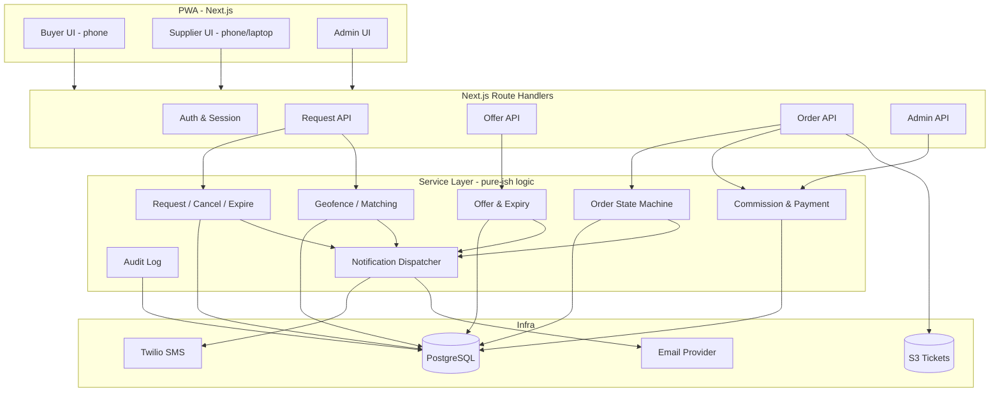
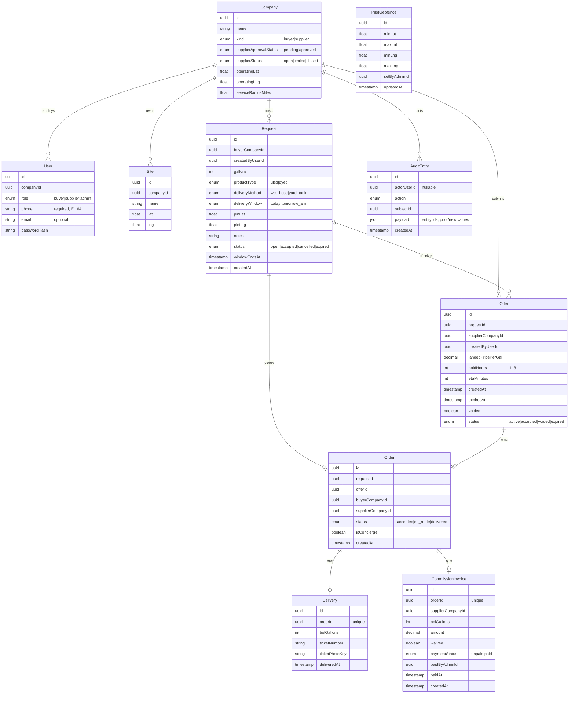

# Design Document: Load Energy

## Overview

Load Energy is a Phoenix-first commercial diesel load board implemented as a mobile-first Progressive Web App (PWA) backed by a marketplace ledger. It coordinates a simple lifecycle — **Request → Offer → Order → Delivery → Commission** — between three roles (Buyer, Supplier, Admin) and earns a commission of $0.02 per delivered BOL gallon, billed to the winning supplier company, with the first two completed wins per supplier waived.

The system is deliberately narrow. It is not a TMS, not a bank, and not a fuel reseller. It stores who asked for fuel, who quoted, who won, how many gallons landed, and what commission is owed and paid — then invoices the winner. Everything outside that loop (fuel payment, title, truck telemetry, tax, auto-dispatch, ML pricing, gasoline/DEF/cardlock, listings/rack feeds, offer withdrawal, gallon tolerance, ticket OCR) is explicitly out of scope for v1. Supplier license verification is an offline Admin process against the ADOT supplier list; the system does not scrape or certify licenses.

### Technology Stack

- **Client**: Next.js (App Router) as an installable PWA, TypeScript, React. Dark, high-contrast UI with large touch targets tuned for field use in sunlight on LTE.
- **API**: Next.js Route Handlers (Node runtime) exposing a REST-style JSON API. A thin service layer holds business logic so it is testable independent of HTTP.
- **Database**: PostgreSQL, accessed through Prisma. Geo distance computed with the Haversine formula in the service layer (no PostGIS dependency required for the pilot radius filter). The Pilot_Geofence is a simple bounding-box check.
- **Notifications**: Twilio for SMS (required); an email provider (e.g., SES/SMTP) for optional email.
- **File storage**: S3-compatible object storage for BOL ticket photos, referenced by key.
- **Payments**: Stripe charging is deferred; Commission_Invoices are ledger records with an Unpaid/Paid state that an Admin toggles manually in v1.

### Design Principles

1. **Ledger, not workflow engine** — persist facts about the marketplace and enforce a minimal state machine.
2. **Pure business logic** — geofence, matching, expiry, acceptance, cancel/expire, commission, and mark-paid are pure functions over data so they can be property-tested without I/O.
3. **Fast field entry** — the buyer new-request path is a single form, geolocation-defaulted, completable in under 60 seconds.
4. **Concierge-friendly** — an admin can inject a completed deal so the pilot loop works even before suppliers self-serve.

## Architecture



### Request Lifecycle Flow

```mermaid
sequenceDiagram
    participant B as Buyer
    participant Sys as Load Energy
    participant N as Notification
    participant S as Supplier
    participant A as Admin

    B->>Sys: Create Request (gallons, product, method, pin, window)
    Sys->>Sys: Reject if pin outside Pilot_Geofence
    Sys->>Sys: Match suppliers (Approved, Open/Limited, in radius, Request Open)
    Sys->>N: New RFQ
    N->>S: SMS + optional email
    S->>Sys: Submit Offer ($/gal, hold 1-8h)
    Sys->>Sys: Compute expiry = now + holdHours
    Sys->>N: New Offer
    N->>B: SMS + optional email
    B->>Sys: Accept one active Offer
    Sys->>Sys: Create Order (Accepted), void other offers, Request -> Accepted
    Sys->>N: Accepted
    N->>S: SMS
    S->>Sys: Mark En_Route
    S->>Sys: Record Delivery + BOL gallons + ticket #
    Sys->>Sys: Order -> Delivered; generate Commission_Invoice (waived if first 2 wins), Unpaid
    Sys->>N: Delivered
    N->>B: SMS
    A->>Sys: Mark Commission_Invoice Paid
    Sys->>Sys: Payment_Status -> Paid, record admin + timestamp, audit
```

### Roles and Authorization

Authorization is enforced in the service layer, keyed off the authenticated User's role and Company:

- **Buyer** — create Sites/Requests for own Company (pin must be inside the geofence), view own Requests/Offers/Orders, accept Offers on own Requests, cancel own Open Requests.
- **Supplier** — set Supplier_Status, view RFQ inbox (only if Approved and Open/Limited, only Open Requests in radius), submit Offers, advance own won Orders, record Deliveries (at most one per Order).
- **Admin** — approve suppliers, set Operating_Location and Service_Radius, configure the Pilot_Geofence, create Concierge Orders, mark Commission_Invoices paid, view commission due. Admin is not scoped to a single trading Company. License verification happens offline (ADOT list) prior to approval.

## Components and Interfaces

The API is thin; each handler validates input, checks authorization, delegates to a service, and shapes the JSON response. Services are the unit of business logic and the primary target of property-based tests.

### Auth & Session

- `POST /api/auth/login` → validates credentials, issues a session (HTTP-only cookie). Returns `{ user, company, role }`.
- `POST /api/auth/logout` → clears session.
- Session middleware resolves `AuthContext { userId, companyId, role }` for every protected route.

### User Service

```typescript
interface UserInput { companyId: string; role: Role; phone: string; email?: string }

// Requires a non-empty E.164-form phone; email optional.
function createUser(input: UserInput): User   // rejects missing/invalid phone with a validation error
```

### Geofence & Matching Service

```typescript
interface LatLng { lat: number; lng: number }
interface Geofence { minLat: number; maxLat: number; minLng: number; maxLng: number }

// True when the pin lies inside the inclusive bounding box.
function isInsideGeofence(pin: LatLng, fence: Geofence): boolean

// Great-circle distance in miles between two points.
function haversineMiles(a: LatLng, b: LatLng): number

// True when the request pin is within the supplier's configured radius of its operating location.
function isWithinRadius(pin: LatLng, operatingLocation: LatLng, radiusMiles: number): boolean

// Suppliers eligible to receive an RFQ: Approved AND Open|Limited AND pin in radius AND request Open.
function matchSuppliers(request: Request, suppliers: SupplierCompany[]): SupplierCompany[]
```

### Request Service

```typescript
interface RequestInput {
  gallons: number; productType: ProductType; deliveryMethod: DeliveryMethod;
  deliveryWindow: DeliveryWindow; pin: LatLng; notes?: string;
}

function createRequest(ctx: AuthContext, input: RequestInput, fence: Geofence, now: Date): Request
  // rejects gallons <= 0 (validation) and pin outside fence (geofence error); status = Open

function cancelRequest(ctx: AuthContext, requestId: string, now: Date): Request
  // owner-only; rejects if not Open; sets Cancelled, voids active offers, audits

function expireRequest(requestId: string, now: Date): Request
  // if Delivery_Window ended and still Open: sets Expired, voids remaining active offers, audits
```

### Offer Service

```typescript
interface OfferInput { requestId: string; landedPricePerGal: number; holdHours: number; etaMinutes?: number }

const MIN_HOLD_HOURS = 1
const MAX_HOLD_HOURS = 8

function createOffer(ctx: AuthContext, input: OfferInput, now: Date): Offer
  // validates price>0, 1<=holdHours<=8, request Open, supplier Approved & Open|Limited
function computeExpiry(createdAt: Date, holdHours: number): Date   // createdAt + holdHours
function isActive(offer: Offer, now: Date): boolean                // now < expiresAt && status === 'active'
```

### Order Service (State Machine)

```typescript
type OrderStatus = 'Accepted' | 'En_Route' | 'Delivered'

function acceptOffer(ctx: AuthContext, offerId: string, now: Date): Order
  // owner-only; request must be Open; offer must be active and owned by a non-Closed supplier;
  // creates Accepted order, voids sibling offers, sets Request -> Accepted, audits, notifies
function advanceStatus(ctx: AuthContext, orderId: string, next: OrderStatus): Order // forward-only
function recordDelivery(ctx: AuthContext, orderId: string, bolGallons: number, ticketNumber: string, ticketPhotoKey?: string): Delivery
  // winning-supplier only; at most one delivery per order; bolGallons>0, ticketNumber required;
  // sets Delivered, generates invoice, audits, notifies
```

Allowed transitions (forward-only): `Accepted → En_Route → Delivered`. Recording a Delivery is permitted directly from `Accepted` (skipping the explicit En_Route mark). Orders are created only at `Accepted` (or `Delivered` for concierge).

### Commission & Payment Service

```typescript
const COMMISSION_RATE_PER_GAL = 0.02
const WAIVED_WIN_LIMIT = 2

// Returns amount in dollars. Waived (zero) for a supplier's 1st and 2nd completed wins.
function commissionAmount(bolGallons: number, priorCompletedWins: number): number

function generateCommissionInvoice(order: Order, delivery: Delivery, priorCompletedWins: number): CommissionInvoice
  // exactly one per delivered order, addressed to winning supplier company, created Unpaid (incl. waived $0)
function markInvoicePaid(ctx: AuthContext, invoiceId: string, now: Date): CommissionInvoice
  // admin-only; sets Paid, records acting admin + timestamp, audits
function commissionDueBySupplier(invoices: CommissionInvoice[]): Map<string, number> // unpaid totals per supplier
```

### Notification Dispatcher

```typescript
type NotificationEvent = 'NEW_RFQ' | 'NEW_OFFER' | 'ACCEPTED' | 'DELIVERED'

interface NotifyResult { channel: 'sms' | 'email'; recipientId: string; ok: boolean; error?: string }

// Sends SMS to every recipient; email additionally where an email is on file.
// Never throws on a single failure; records and continues.
function dispatch(event: NotificationEvent, recipients: Recipient[]): NotifyResult[]
```

### Admin Service

```typescript
function approveSupplier(ctx: AuthContext, supplierCompanyId: string): SupplierCompany
function setOperatingLocation(ctx: AuthContext, supplierCompanyId: string, location: LatLng): SupplierCompany
function setServiceRadius(ctx: AuthContext, supplierCompanyId: string, radiusMiles: number): SupplierCompany // radius>0
function setGeofence(ctx: AuthContext, fence: Geofence): Geofence // applies to new requests
function createConciergeOrder(ctx: AuthContext, input: ConciergeInput): Order // Delivered order + delivery + invoice + audit
```

### Audit Service

```typescript
type AuditAction =
  | 'OFFER_SUBMITTED' | 'OFFER_ACCEPTED' | 'REQUEST_CANCELLED' | 'REQUEST_EXPIRED'
  | 'STATUS_CHANGED' | 'CONCIERGE_CREATED' | 'INVOICE_PAID'

// Append-only. Never updates or deletes existing entries.
function append(entry: AuditEntryInput): AuditEntry
```

## Data Models



### Model Notes

- **Company** carries both buyer and supplier attributes; supplier-only fields (`supplierStatus`, `supplierApprovalStatus`, `serviceRadiusMiles`, `operatingLat/Lng`) are null for buyer companies. `operatingLat/Lng` and `serviceRadiusMiles` are Admin-set and are the origin/radius for matching.
- **User.phone** is required and stored in E.164 (or equivalent) form; `email` is optional. User creation without a phone is a validation error.
- **Request.status** is the four-state model `open | accepted | cancelled | expired`. Orders are created only from acceptance (or concierge); there is no `Quoted` state. `windowEndsAt` derives from `deliveryWindow` and drives expiry.
- **Offer.status** captures the offer lifecycle: `active` while quotable, `accepted` when it wins, `voided` when a sibling wins or the request is cancelled/expired, `expired` after `expiresAt`. Expiry is evaluated lazily by comparing `now` to `expiresAt`. `holdHours` is constrained to 1–8 at creation.
- **Order** is created at `Accepted` (app path) or `Delivered` (concierge path). Order_Status is only `accepted | en_route | delivered`.
- **Delivery.orderId** is unique — at most one Delivery per Order. `ticketNumber` is required; `ticketPhotoKey` is optional.
- **CommissionInvoice** has a unique `orderId` (exactly one per delivered order), a `waived` flag (true for the supplier's first two completed wins, amount 0), and a `paymentStatus` created as `unpaid` even when the amount is 0. `paidByAdminId` and `paidAt` are set when an Admin marks it paid.
- **AuditEntry** is append-only; the persistence layer exposes insert and read but no update/delete. `actorUserId` is nullable (e.g., system-driven request expiry). `payload` carries entity ids and prior/new values where relevant.
- **PilotGeofence** is a single Admin-configured bounding box applied to new Requests.

## Correctness Properties

A property is a characteristic or behavior that should hold true across all valid executions of a system — a formal statement about what the system should do. Properties serve as the bridge between human-readable specifications and machine-verifiable correctness guarantees. Each property below is universally quantified ("for all/any") and is intended to be implemented as a single property-based test.

The prework analysis consolidated redundant criteria so each property carries unique validation value: the seven matching/visibility criteria collapse into one predicate (Property 9), the two offer-expiry criteria into one boundary property (Property 15), the acceptance criteria into one exclusivity property (Property 17), the delivery uniqueness criteria into the delivery round trip (Property 24), the waiver criteria into one amount property (Property 26), the six audited-action criteria into one action/shape property (Property 34), and the seven authorization criteria into one enforcement property (Property 36). Criteria judged non-testable (role-specific interface rendering, 44×44 touch targets) and example-only criteria (login success/failure, order status read, PWA shell, geolocation default pin) are covered by unit tests in the Testing Strategy rather than by properties. The result is the focused property set below.


### Property 1: User round trip with required phone and optional email
*For any* valid User input (a Company, a role, a non-empty E.164-form phone, and an optional email), creating the User and reading it back returns a User linked to exactly that one Company, with the same role, the same phone, and the same email when supplied (absent otherwise).
**Validates: Requirements 1.3, 1.4, 1.5, 1.7**

### Property 2: User creation requires a phone
*For any* User input lacking a phone number, User creation is rejected with a validation error.
**Validates: Requirements 1.6**

### Property 3: Site round trip and tenant isolation
*For any* Buyer and any valid Site input (name plus in-range coordinates), creating the Site and then listing that company's Sites returns a Site with the same name and coordinates, and listing never returns a Site (or Request/Order) belonging to another Company.
**Validates: Requirements 2.1, 2.2, 2.3, 3.9**

### Property 4: Coordinate validation rejects out-of-range pins
*For any* coordinate with latitude outside [-90, 90] or longitude outside [-180, 180], Site creation is rejected with a validation error.
**Validates: Requirements 2.4**

### Property 5: Request round trip with valid enums
*For any* valid Request input (gallons > 0; pin inside the Pilot_Geofence; productType in {ULSD, Dyed}; deliveryMethod in {Wet_Hose, Yard_Tank}; deliveryWindow in {Today, Tomorrow_AM}; optional notes), creating the Request produces a Request with status Open, the same field values (including notes when supplied), and links to the creating Buyer and Company.
**Validates: Requirements 3.1, 3.2, 3.3, 3.4, 3.7, 3.8**

### Property 6: Non-positive gallons rejected
*For any* Request input with gallons ≤ 0, Request creation is rejected with a validation error.
**Validates: Requirements 3.5**

### Property 7: Geofence membership governs Request acceptance
*For any* Pilot_Geofence bounding box (including one just updated by an Admin) and any location pin, Request creation succeeds when the pin lies inside the box (bounds inclusive) and is rejected with a geofence error when the pin lies outside it; that is, acceptance agrees exactly with bounding-box membership against the currently configured fence.
**Validates: Requirements 3.6, 16.7**

### Property 8: Haversine distance is well-formed
*For any* two coordinate pairs a and b, haversine distance is non-negative, equals zero when a == b, and is symmetric (distance(a,b) == distance(b,a)).
**Validates: Requirements 4.2**

### Property 9: Supplier matching predicate
*For any* Request and any set of Supplier Companies, the matched (RFQ-visible) suppliers are exactly those whose Supplier_Approval_Status is Approved AND whose Supplier_Status is Open or Limited AND whose Operating_Location is within the configured Service_Radius of the Request pin AND whose Request_Status is Open; Closed suppliers, Pending suppliers, out-of-radius suppliers, and non-Open (Cancelled/Expired/Accepted) requests are all excluded.
**Validates: Requirements 4.1, 4.3, 4.4, 4.5, 4.6, 4.7, 5.3, 9.4, 16.3**

### Property 10: Supplier status persistence round trip
*For any* Supplier Company and any status value in {Open, Limited, Closed}, setting the status and then reading it returns the same status.
**Validates: Requirements 5.1, 5.2**

### Property 11: Offer submission is gated by supplier status and approval
*For any* Supplier whose Supplier_Status is Closed or whose Supplier_Approval_Status is Pending, submitting an Offer is rejected with an error.
**Validates: Requirements 5.4, 5.5**

### Property 12: Offer round trip and expiry computation
*For any* valid Offer input (landedPrice > 0, holdHours in [1, 8], optional ETA) created at time t on an Open Request, the created Offer stores the same price and ETA, links to its Request and Supplier Company, and has expiresAt equal to t plus holdHours.
**Validates: Requirements 6.1, 6.2, 6.3**

### Property 13: Offer input validation including hold bound
*For any* Offer input with landedPrice ≤ 0 or holdHours outside the inclusive range [1, 8], Offer creation is rejected with a validation error; and for any holdHours within [1, 8] with a positive price, creation is accepted.
**Validates: Requirements 6.4, 6.5**

### Property 14: Offer view contains required fields and activeness indicator
*For any* Offer returned to a Buyer, the view includes the Supplier name, landed price, ETA, and expiry, and an active/expired indicator consistent with the current time.
**Validates: Requirements 6.6, 7.4**

### Property 15: Offer activeness boundary
*For any* Offer and any evaluation time now, the Offer is active when now < expiresAt and its status is active, and expired when now ≥ expiresAt.
**Validates: Requirements 7.1, 7.2**

### Property 16: Expired offers cannot be accepted
*For any* Offer whose expiresAt is at or before the acceptance time, accepting it is rejected with an expiry error.
**Validates: Requirements 7.3**

### Property 17: Acceptance produces one exclusive, linked, visible order
*For any* Open Request with one or more active Offers, when the owning Buyer accepts one active Offer: an Order is created with status Accepted linking that Request, Offer, and winning Supplier Company; the Request_Status becomes Accepted; every other active Offer on the Request becomes voided; and the Order appears in the winning Supplier Company's won-orders list.
**Validates: Requirements 8.1, 8.2, 8.3, 8.7**

### Property 18: Acceptance requires an Open request
*For any* Request whose Request_Status is not Open (already Accepted, Cancelled, or Expired), any acceptance attempt is rejected with an error.
**Validates: Requirements 8.4**

### Property 19: Offers from Closed suppliers cannot be accepted
*For any* Offer whose owning Supplier Company's Supplier_Status is Closed, an acceptance attempt is rejected.
**Validates: Requirements 8.6**

### Property 20: Cancelling an Open request voids its offers
*For any* Open Request with active Offers, when the owning Buyer cancels it, the Request_Status becomes Cancelled and every active Offer on the Request becomes voided.
**Validates: Requirements 9.1**

### Property 21: Cancellation requires an Open request
*For any* Request whose Request_Status is not Open, a cancellation attempt is rejected with an error.
**Validates: Requirements 9.2**

### Property 22: Expiry after window end voids remaining offers
*For any* Open Request whose Delivery_Window end time has passed, expiring the Request sets the Request_Status to Expired and voids every remaining active Offer on the Request.
**Validates: Requirements 9.3**

### Property 23: Order status advances forward-only
*For any* Order and any sequence of status-change requests, the status only ever moves forward along Accepted → En_Route → Delivered (recording a Delivery may advance directly from Accepted to Delivered); any request that would move it backward is rejected, and the persisted status always reflects the last valid forward transition.
**Validates: Requirements 10.1, 10.2, 10.3, 10.4, 10.5**

### Property 24: Delivery recording sets Delivered, stores details, and is unique per order
*For any* won Order without an existing Delivery and any valid Delivery input (bolGallons > 0, ticket number, optional ticket photo), recording the Delivery creates exactly one Delivery linked to the Order, sets the Order status to Delivered, and stores any provided ticket photo; a second Delivery on the same Order is rejected.
**Validates: Requirements 11.1, 11.2, 11.3, 11.6**

### Property 25: Delivery input validation
*For any* Delivery input with bolGallons ≤ 0 or without a ticket number, recording the Delivery is rejected with a validation error.
**Validates: Requirements 11.4, 11.5**

### Property 26: Commission amount depends on prior wins and gallons
*For any* delivered Order with bolGallons g and priorCompletedWins n for the winning Supplier Company, the commission amount is 0 and the invoice is flagged waived when n < 2 (the company's 1st and 2nd completed wins), and the amount is g × 0.02 with the waived flag clear when n ≥ 2; the waiver boundary at n = 1, 2, 3 is exercised explicitly.
**Validates: Requirements 12.2, 12.3**

### Property 27: Delivered orders generate exactly one addressed, unpaid invoice
*For any* Order that reaches Delivered with recorded BOL gallons (app-originated or concierge), exactly one Commission_Invoice is generated, addressed to the winning Supplier Company, created with Payment_Status Unpaid (including waived $0 invoices), and invoice generation is idempotent when invoked more than once.
**Validates: Requirements 12.1, 12.4, 17.3**

### Property 28: No invoice before delivery
*For any* Order that has not reached Delivered, no Commission_Invoice exists for that Order.
**Validates: Requirements 12.5**

### Property 29: Admin mark-paid records payment state and never reverts
*For any* Unpaid Commission_Invoice (including a waived $0 invoice) and any Admin, marking it paid sets the Payment_Status to Paid and persists the acting Admin's id and the timestamp; repeating the operation leaves the invoice Paid, so Payment_Status never moves back to Unpaid.
**Validates: Requirements 12.6**

### Property 30: Commission due aggregates unpaid invoices per supplier
*For any* set of Commission_Invoices, the admin commission-due report returns, for each Supplier Company, the sum of that company's Unpaid invoice amounts and excludes Paid invoices.
**Validates: Requirements 12.8**

### Property 31: Marketplace events notify the correct recipients
*For any* marketplace event, notifications target the correct recipients: NEW_RFQ to every matched Supplier, NEW_OFFER to the owning Buyer, ACCEPTED to the winning Supplier, and DELIVERED to the owning Buyer.
**Validates: Requirements 13.1, 13.2, 13.3, 13.4**

### Property 32: Notification channel selection
*For any* recipient of a notification, an SMS attempt is always made to the recipient's phone, and an email attempt is additionally made if and only if the recipient has an email address on file.
**Validates: Requirements 13.5, 13.6**

### Property 33: Notification dispatch is resilient
*For any* set of recipients where some deliveries fail, dispatch attempts delivery to every recipient, records each failure, and does not raise.
**Validates: Requirements 13.7**

### Property 34: Audited actions append matching entries
*For any* audited action (offer submitted, offer accepted, request cancelled or expired, order status changed, concierge order created, invoice marked paid), an Audit_Log entry is appended capturing the acting User where any, the subject entity ids, and — for status/state changes (order status, request cancel/expire, invoice paid) — the prior and new values.
**Validates: Requirements 14.1, 14.2, 14.3, 14.4, 14.5, 14.6, 17.4**

### Property 35: Audit log is append-only and monotonic
*For any* sequence of audited actions, existing Audit_Log entries are never modified or removed and the entry count only increases.
**Validates: Requirements 14.7**

### Property 36: Role-based authorization is enforced
*For any* User acting outside their role or company scope — a non-owning company accepting or cancelling a Request/Offer, a non-winning Supplier recording a Delivery, a non-Admin marking an invoice paid, approving a supplier, setting operating location / radius / geofence, or creating a concierge order — the action is denied with an authorization error.
**Validates: Requirements 1.9, 8.5, 9.5, 11.7, 12.7, 16.8, 17.5**

### Property 37: Admin approval and configuration lifecycle
*For any* newly created Supplier Company, its Supplier_Approval_Status is Pending; after an Admin approves it, the status is Approved; and after an Admin sets an Operating_Location, a Service_Radius > 0, and the Pilot_Geofence, reading the company and geofence returns those configured values.
**Validates: Requirements 16.1, 16.2, 16.4, 16.5, 16.7**

### Property 38: Non-positive radius rejected
*For any* Service_Radius value ≤ 0, the set-radius operation is rejected with a validation error.
**Validates: Requirements 16.6**

### Property 39: Concierge order lands as a delivered order
*For any* valid concierge input (Buyer Company, winning Supplier Company, bolGallons > 0, optional ticket number) submitted by an Admin, an Order with status Delivered and an associated Delivery is created, storing the ticket number when provided.
**Validates: Requirements 17.1, 17.2**

## Error Handling

The system distinguishes five error categories, each mapped to a consistent HTTP response and a stable error code so the PWA can react appropriately in the field.

| Category | HTTP | Example causes | Client behavior |
|----------|------|----------------|-----------------|
| Validation | 400 | gallons ≤ 0, price ≤ 0, hold outside 1–8, radius ≤ 0, BOL ≤ 0, missing ticket number, missing phone, out-of-range coordinates, invalid enum | Inline field message; do not clear the form |
| Geofence | 422 | request pin outside the Pilot_Geofence | Show "outside service area"; keep the pin editable |
| Authentication | 401 | invalid credentials, missing/expired session | Redirect to sign-in |
| Authorization | 403 | out-of-role action, non-owner accept/cancel, non-winning delivery, non-admin admin/mark-paid action | Show "not permitted"; hide the control |
| Conflict/State | 409 | accept expired offer, accept/cancel on non-Open request, accept a Closed supplier's offer, backward status transition, second delivery on an order, offer while Closed/Pending | Refresh the resource and show current state |

Additional handling rules:

- **Offer expiry** is evaluated lazily at read and at acceptance by comparing `now` to `expiresAt`; acceptance of an expired offer returns a 409 with code `OFFER_EXPIRED`.
- **Geofence rejection** returns 422 with code `OUTSIDE_GEOFENCE` and echoes the configured bounding box for client messaging.
- **Request expiry** (window ended while Open) is applied lazily when the Request or matching is next evaluated; it voids remaining active offers and writes an audit entry.
- **Notification failures** are isolated: `dispatch` catches per-recipient/per-channel errors, records them (log + `notification_failures` table), and continues. A failed SMS never blocks order progression.
- **Idempotent invoice generation** is guarded by a unique constraint on `CommissionInvoice.orderId`; a duplicate attempt is a no-op returning the existing invoice.
- **Single delivery** is guarded by a unique constraint on `Delivery.orderId`; a second attempt returns 409 with code `DELIVERY_EXISTS`.
- **File upload failures** (S3) for ticket photos are non-fatal: the Delivery still records gallons and ticket number; the photo key is left null and can be retried.
- All error responses share the shape `{ error: { code: string, message: string, field?: string } }`.

## Testing Strategy

The project uses a dual approach: **property-based tests** for universal correctness and **unit tests** for specific examples, edge cases, and integration points. Both are required and complementary.

### Property-Based Testing

- **Library**: `fast-check` (the standard PBT library for the TypeScript/Node ecosystem). Property-based testing MUST NOT be implemented from scratch.
- **Coverage**: Each of the 39 correctness properties above is implemented by exactly one property-based test.
- **Iterations**: Each property test runs a minimum of 100 iterations (`fc.assert(..., { numRuns: 100 })` or higher).
- **Generators**: Custom `fast-check` arbitraries model domain data — users (with/without phone, with/without email), companies (buyer/supplier with approval + status + operating location + radius), coordinates (in/out of range, inside/outside geofence), requests (valid enums + boundary gallons + Open/Cancelled/Expired/Accepted states + window-end times), offers (price/hold boundaries at 0, 1, 8, 9; varied `now`/`expiresAt`), orders, deliveries (valid + missing ticket + non-positive gallons), invoices (waived/unwaived, paid/unpaid across win counts), and recipients (with/without email). Generators deliberately include edge cases identified in prework: hold-hour boundaries (1 and 8 inclusive), coordinate and geofence extremes, expiry boundary times, and the first-two-wins waiver boundary.
- **Tagging**: Each property test is tagged with a comment in the format
  `// Feature: load-energy, Property {number}: {property_text}`.
- **Target**: Property tests exercise the pure service-layer functions (geofence, matching, expiry, acceptance, cancel/expire, state machine, commission, mark-paid, notification channel selection, audit append) against an in-memory repository so they run fast and deterministically.

### Unit Testing

Unit tests focus on concrete examples and integration points rather than duplicating property coverage:

- **Auth**: successful login example (Req 1.1) and invalid-credential rejection (Req 1.2).
- **Order read**: buyer reads current order status reflecting the last transition (Req 10.6).
- **PWA shell**: web app manifest validity and service worker registration (Req 15.1); the New Request form renders gallons, product, method, pin, and window inputs (Req 15.2); geolocation default pin with a mocked geolocation source (Req 15.3).
- **Integration**: end-to-end happy path through the service layer + Postgres (request → matched suppliers → offer → accept → en route → delivered → invoice → mark paid), the cancel/expire path, and the concierge path.
- **Error mapping**: representative validation/geofence/authz/conflict cases map to the correct HTTP codes and error codes.

Unit tests are kept lean; broad input coverage is the job of the property tests. UI aesthetic requirements (Req 15.4 touch-target sizing, Req 1.8 role interfaces) are verified by design/manual review rather than automated tests, as noted in the prework as non-computable.

### Test Configuration Summary

- Each correctness property → one `fast-check` property test, ≥ 100 runs, tagged with its property number.
- Unit tests via the project test runner (e.g., Vitest) for examples and integration.
- Service-layer logic is pure over an injected repository interface, enabling fast in-memory property tests and a Postgres-backed integration suite.
